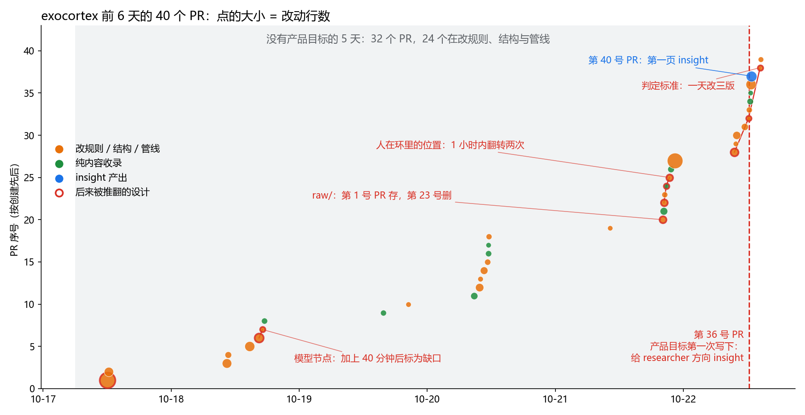
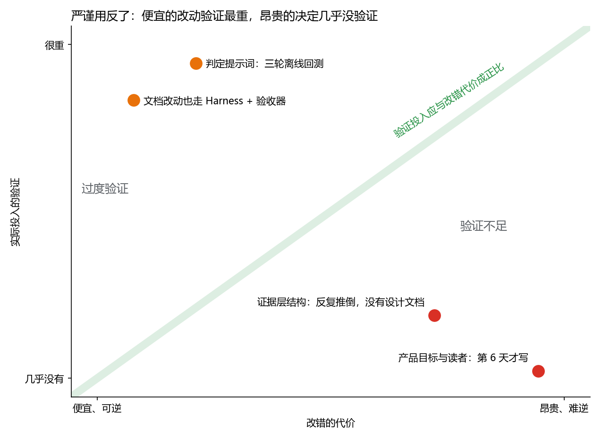
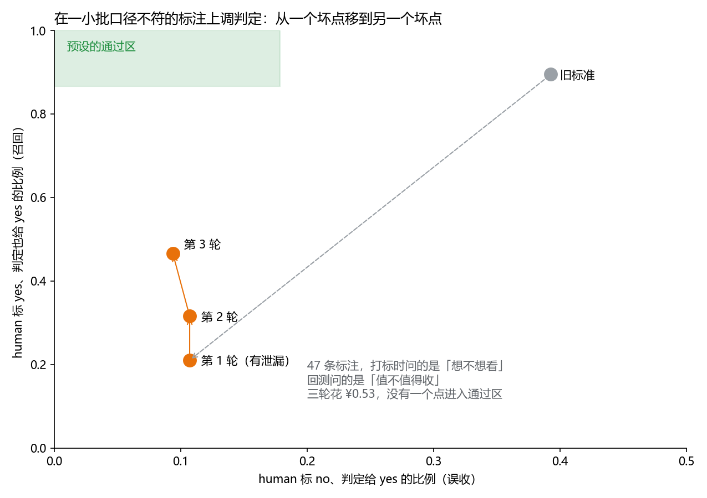
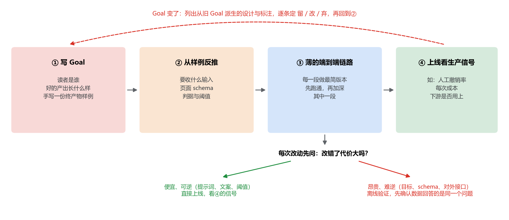

# 先有终产物，再有管线：一个 agentic 项目 6 天 40 个 PR 的复盘（v0.1）

人写代码时实现很贵，这份成本逼着人先想清楚要做什么。coding agent 把一个 PR 的成本降到几分钟，这道约束就没了：**实现比想清楚更便宜，「边做边想」成了默认节奏。** 想法直接变成 PR，设计藏在实现里，目标要等做出足够多的东西之后才浮现。

[exocortex](https://github.com/ZJLi2013/exocortex) 的前 6 天把这个机制完整演示了一遍：40 个 PR，产品目标在第 36 号才第一次写下，之前的大部分设计在目标出现后被推翻或返工。同一个机制还带出另外两个问题：

- agent 不嫌麻烦，严谨会流向容易执行的地方，而不是改错代价大的地方；
- agent 照做比质疑快，人随口提的方案会被当成约束，一路执行下去。

本文按这三个后果组织，每节给出对策。对策的共同点是把「想清楚」放回实现之前，而且只放在改错代价大的地方。末尾给一份清单。

## 项目背景

exocortex 按 [LLM Wiki](https://gist.github.com/karpathy/442a6bf555914893e9891c11519de94f) 组织，整个仓库是一个 Obsidian vault。两个 agent 分工：collector 持续收录新工作，维护中立的证据层（来源页、研究方向页）；insight agent 读证据层，为每个方向写判断，包括下一步值得做什么、未解决的问题、可证伪的预测。一台本地 GPU 机器每天早上定时跑：抓 GitHub feed，用 LLM 判定哪些值得收，再让一个无头 agent 收录前 5 条并自动合并，一次收录约 ¥0.28。

开发方式是一个人加一个 coding agent（Cursor + Claude），配合自己维护的 agent 工作流规则 [agent-loop](https://github.com/ZJLi2013/agent-loop)。

## 一、目标后置：便宜的 PR 把设计藏进了实现



第 36 号 PR 之前的 32 个 PR 里，只有 8 个是纯内容收录，其余 24 个在改规则、页面结构和管线。每个改动几分钟就能做完，于是每个设计都是先做出来再说；没有目标可以对照，只能按「看起来合理」来定，目标一出现就要重新评估：

| 被推翻的设计 | 时间跨度 | 推翻它的原因 |
|---|---|---|
| 判定标准：「human 会不会 star」→「只收判 yes 的」→「值不值得收」 | 1 天，3 个 PR | 目标从「收我想看的」变成「给方向判断提供证据」 |
| 候选交给人挑 → 人处置一批 → 直接收录、人只撤销 | 1 小时，3 个 PR | 人挑 10 条只留 2 条，挑的成本高于撤销 |
| 原文存进 `raw/` → 收录时现读 | 4 天 | 每条来源都要临时写抽取脚本才存得干净；去重和回查改由来源页完成 |
| 模型节点关联来源 → 40 分钟后标为已知缺口 | 40 分钟 | 节点粒度太粗，关联不出信息 |

这些翻转单看都不贵，一个 PR 几分钟就改完。贵的是第一页 insight（第 40 号 PR）写出来时才暴露的问题：**证据层里 0 条负面结果，来源之间 0 条「相悖」关系，也没有立场文章。** insight 要判断「哪条路走不通」「谁和谁结论冲突」，而前 5 天的收录格式完全围绕评测数字设计，抓不到这些。旧判定标准下，40 个候选有 37 个判了 yes，推理框架、数据集都放了进来，对「方向判断」没有用。

如果第 1 天就手写一页假的 insight，这些缺口当天就能看到：先写出终产物，才知道要收什么、按什么格式收、按什么标准判。

**做法 1：写管线之前，先写目标，并手写一份终产物样例。** 目标要说清楚读者是谁、好的产出长什么样。输入、schema、判定标准都从这份样例反推。

**做法 2：先打通一条薄的端到端链路，再加深其中一段。** 收录、判断、成页三段各做最简版本先跑通。exocortex 把收录段打磨了 5 天，才第一次跑到下游。

## 二、严谨用反了：便宜的改动验证最重，昂贵的决定几乎没验证

实现便宜，验证也一样便宜：agent 跑一轮回测、走一遍验收器都不嫌麻烦，严谨于是流向了容易执行的地方。



这 6 天里流程最重的地方，恰恰是最便宜、最可逆的改动：改文档也走状态机和锁定验收器，改一句判定提示词跑了三轮离线回测。最昂贵、最难逆的两个决定反而几乎没有验证：产品目标和读者第 6 天才写，证据层结构反复推倒，却从没有过设计文档。

三轮回测这件事最典型：



回测用的是 47 条人工标注。打标时问的是「想不想看」，回测要判的却是「值不值得收」，两个问题不一样。在这批口径不符、本身就带噪声的小样本上，agent 为了达标，往判定里加了三道硬门槛：和库里逐篇比新颖性、只看研究方向范围句、排除清单。三轮共花 ¥0.53，召回从 17/19 掉到 7/15，没有一个点进入预设的通过区。最后叫停的是人：「不值得就在这个数据样本上反复调策略。」

最终上线的方案没有在这批标注上验证。它是一段直接陈述库的目的的提示词（见下一节），上线后看每天的撤销率。提示词改错了，明天再改就是，生产信号比 47 条错口径标注可靠得多。

**做法 3：验证投入与改错的代价成正比。** 提示词、文案、阈值这类便宜可逆的改动直接上线，看生产信号；目标、schema、对外接口这类昂贵难逆的决定才做离线验证。离线验证开跑前先问两件事：这批数据回答的问题和要判的问题是同一个吗？结果为真、为假时，下一步命令各是什么？两条命令一样，就别跑。

## 三、LLM as policy，优于手写门槛

上一节的硬门槛也来自同一个倾向：门槛能写成代码、能回测，看起来比一句判断更像在做事。可是三道门槛每一道都编码了设计者的一个猜测。叠在一起，误杀是系统性的：用研究方向范围句判，判定就退化成主题匹配（另一次验收里精确率只有 6/12）；跟库里逐篇比新颖性，论文的官方代码仓库会被当成「复现」判掉；排除清单则把托管在 GitHub 上的研究项目判成了「工具」。

最后合并的判定（[PR #41](https://github.com/ZJLi2013/exocortex/pull/41)）只有一段提示词，讲清楚库的目的，让模型整体判断：

```text
exocortex 是一个研究知识库，目的是给领域 researcher 方向 insight：下一个值得做的方向、
未解决的问题、可证伪的预测。你决定一个工作（GitHub 仓库、论文、博客或模型页）值不值得
收进这个库，也就是它能不能成为这类 insight 的证据或启发。
下面 human 的 star、在做的仓库与标注，帮你了解他关心什么，不必局限于此。只依据给的内容，不要猜。
```

star、自己的仓库、过往标注都只作上下文，不作门槛。

**做法 4：默认把目的、上下文和例子交给 LLM 整体判断；只有复现过的失败才加规则。** 一条规则对应一个已复现的失败，而且要写清楚它防的是什么。

## 四、目标变了，旧设计要逐条过一遍；agent 要敢质疑人的方案

照做比质疑快，这是第三个后果。「human 会不会 star」这个判定标准是人早先提出的。目标改成「方向 insight」之后，它和新目标明显冲突，agent 却继续在它的基础上调参，还把人随口提过的设计细节当成硬约束执行。最后是人自己说：「不要被我的可能不好的设计误导了。」

另一个症状出在 agent 给人的选择题上：三个选项经常是当前路线的三种变体（再跑一轮、换个阈值、补个上下文），没有「停下来，回到目标」这个选项。

**做法 5：目标一变，列出从旧目标派生的设计与评测数据，逐条定留、改、弃。** 人提出过的设计也在其列，由人拍板，但 agent 要先指出冲突。给人的选项里，至少留一个「停下来回主线」。

## 五、流程工具要按项目判断，不能按单个请求判断

工作流工具的默认假设也建立在「实现很贵」之上。agent-loop 的规则规定「一问一答、单文件小改直接做」，不进工作流，前提是小改风险低、数量少；agent 让小改又多又快，一串小改就能把整个项目重塑一遍。exocortex 前 5 天的每个请求看起来都是小改，于是一次都没进环，项目级的目标也就一直没写，尽管 agent-loop 本身就要求「先写 Goal，再拆 task」。反过来，进环之后连改文档都要走完整的验收流程。

这两处已作为 agent-loop 的缺陷提了 issue：

- [#67](https://github.com/ZJLi2013/agent-loop/issues/67)：豁免按项目判断。一个项目还没有目标、又第二次改规则或结构时，先写目标和终产物样例。
- [#68](https://github.com/ZJLi2013/agent-loop/issues/68)：目标变更时，同步的对象从 task 扩展到旧目标派生的设计与评测数据。

**做法 6：流程强度跟着改动风险走，不跟着工具默认走。** 一串小改在不断改写同一个项目的结构，就说明缺一份设计；一个可逆的文档改动，不需要验收器。

## 值得保留的

- 证据层只记事实，判断只写进 insight 页，两边不互相搬运。
- 只碰收录类路径的 PR 自动合并，人只做撤销。
- 每次判定和收录都记一笔模型开销，月度目标 ¥20。
- 文档只保留 as-built 内容；被否决的方案写进设计文档，附否决理由。不过这份记录只有在设计之前去查才有用，第二节的硬门槛里有一道就是早已被否决过的方案。

## 清单（v0.1）



1. 写管线之前，写目标：读者是谁、好的产出长什么样，并手写一份终产物样例。
2. 先打通一条薄的端到端链路，再加深其中一段。
3. 验证投入与改错的代价成正比。可逆的改动上线看信号；离线验证前先确认数据和问题同口径，并写出结果为真、为假时各自的下一步命令。
4. 默认 LLM as policy：给目的、上下文和例子；规则只为复现过的失败而加。
5. 目标变了，逐条过旧设计与评测数据；agent 要指出人的方案与目标的冲突，选项里留一个「停下来」。
6. 流程强度按项目和风险判断：一串小改在重塑结构，就该停下写设计；可逆的小改不走重流程。
7. 设计之前，按机制名搜一遍被否决的方案。
8. 执行卫生：有依赖的调用不并行，复杂命令写成脚本，密钥文件先校验格式再加载，回测前从上下文里去掉被测样本。这几条在本项目里各白烧过一轮。

这是 v0.1，样本只有一个项目、6 天。后续项目里，按这份清单做的部分和没做的部分各自出了什么问题，会补进下一版。

---

*AI 使用说明：初稿由 Cursor agent（Claude Opus）根据 exocortex 的 PR 记录与开发对话起草，文中 4 张图由 agent 用 matplotlib 从真实 PR 数据和回测记录绘制，不是生成图。作者审阅并修改后发布。*
