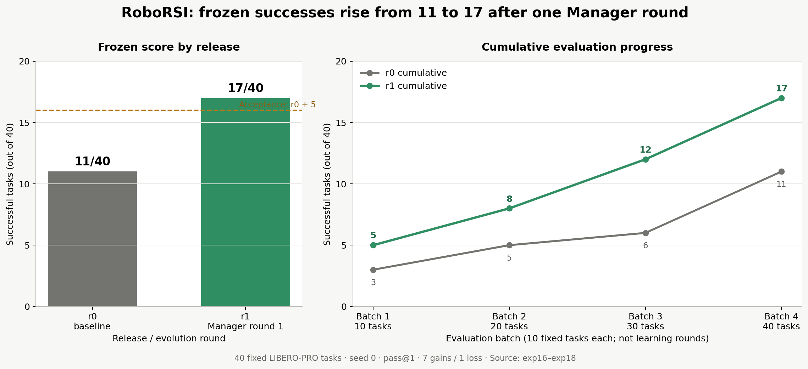
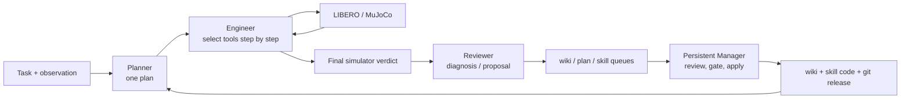
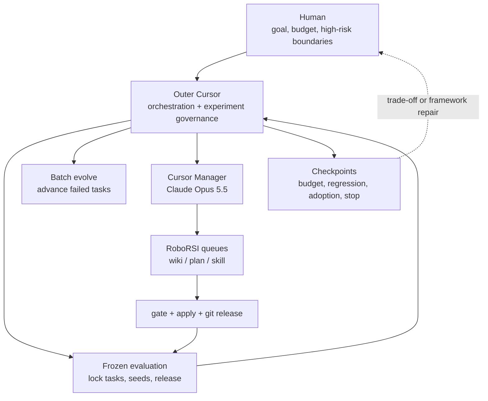
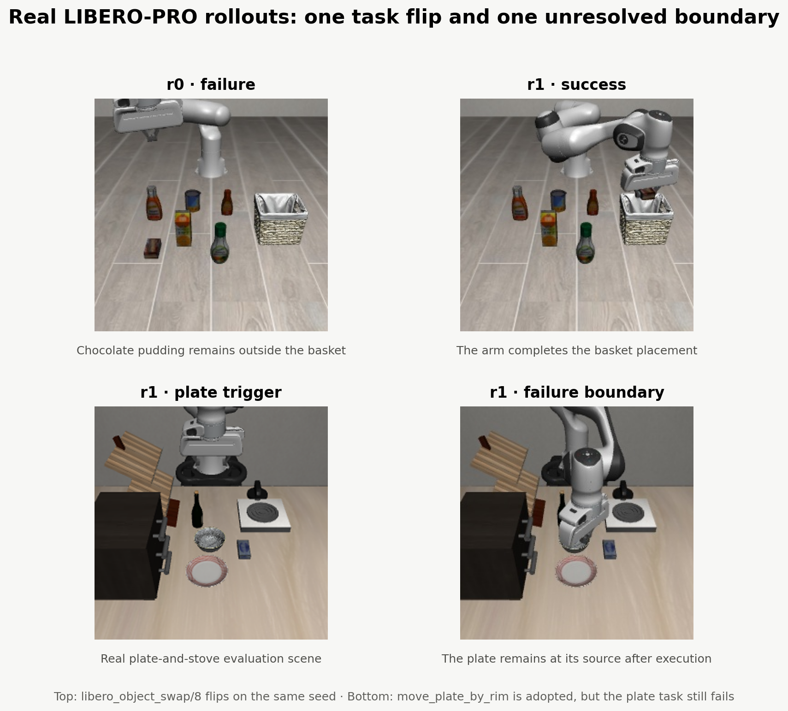
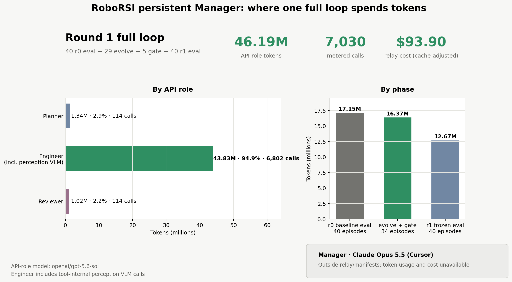

<!--
Suggested front matter for a static-site generator:
title: "$93.90 to Reproduce One RoboRSI Round: What We Learned"
description: "A fixed-task-set validation of one RoboRSI loop: how failures become wiki entries, skills, and a new release; how that release is frozen and re-evaluated; and where the tokens go."
cover: "images/persistent-manager-rsi-curve-en.png"
-->

# $93.90 to Reproduce One RoboRSI Round: What We Learned

**On a fixed set of 40 LIBERO-PRO tasks, RoboRSI's frozen success count rose from 11/40 on r0 to 17/40 on r1.**
This was one complete `evaluate → evolve failures → Manager adoption → new release → frozen re-evaluation` loop. The reproduction tested whether failures could pass through an auditable adoption chain, become a new release, and change behavior on the exact same frozen task set.

## Learning Expands from Model Weights to the Execution Stack

[RoboRSI](https://github.com/nssmd/RoboRSI) does not ask one large model to emit robot joint commands directly. It separates robot execution across two timescales.

Inside each episode, three roles participate:

1. **Planner** reads the task and skill documentation and produces an execution plan.
2. **Engineer** owns the simulator loop, choosing a public tool and filling its arguments at every step.
3. **Reviewer** reads the trace after the episode, identifies the earliest failure, and proposes a diagnosis, plan, or skill candidate.

Outside the episode, a session-persistent **Manager** reads code, traces, and four review queues. It rejects bad diagnoses, authors skills when needed, runs the gate, applies accepted changes, and commits them to git.

The retained capability therefore does not live only in a model. It can live in:

- the wiki, which records failure patterns the Planner should avoid;
- a seed plan, which captures a generic procedure for a task family;
- a base skill, which is executable, testable, and versioned;
- a release, which freezes a set of Manager-adopted artifacts.

This is what separates RoboRSI from ordinary "reflect and retry." An insight inside one conversation is not inheritance. It enters the next system version only after it is written into a persistent artifact and then read or called by a later frozen run.

## The Real Setup Added an Outer Cursor Layer for Orchestration and Governance

The roles and artifacts above belong to RoboRSI. The project provides individual evaluation and evolve commands, queues, apply paths, and `roborsi manager`, but it does not ship a controller that automatically performs:

`frozen evaluation → select failed tasks → batch evolve → resume Manager → wait for empty queues → seal release → re-evaluate → stop or continue`

An outer agent was still required. In this experiment, a Cursor session handled that orchestration and governance. The actual setup had four layers:

The outer Cursor session used GPT-5.6 Sol to:

- translate the goal into a fixed task set, acceptance threshold, budget, and early-stop rules;
- isolate branches, state, and seeds across r0, the sandbox, and r1;
- launch evaluation and evolve jobs remotely, then inspect logs, failure counts, and token accounting;
- create and resume an independent Manager, verify its commits, and seal the release;
- run an independent Harness reviewer over the plan, task boundaries, and final evidence.

The result therefore validates a real loop composed of **RoboRSI's inner evolution components plus an outer Cursor controller**. It does not show that RoboRSI already contains a fully autonomous multi-round autopilot. Cursor is not algorithmically necessary: a project-native `evolve-loop` controller could implement the same state machine, budget gates, and release protocol.

## One Closed Loop

Evaluation and evolution were kept separate.

### Baseline Release r0

We stratified LIBERO-PRO's 120 tasks by 12 perturbation families and locked 40 tasks before the experiment. Every frozen evaluation used seed 0 and pass@1. r0 ran one fixed code release with a fresh state directory and scored 11/40.

Only the final simulator predicate counted as success. The Engineer's own completion claim did not affect the verdict: a confident "done" still counted as failure when the environment predicate failed.

The 40 tasks were fixed into four batches of ten before execution. A batch represented evaluation progress, not a learning round. Each completed batch was compared against the matching r0 batch.

### Evolution Round 1: Producing r1 from r0

#### 1. Failed Tasks Enter Evolve

Each of r0's 29 failed tasks ran one evolve episode at seed 1. Using a different seed kept development away from the frozen acceptance seed. These 29 episodes produced:

- 22 wiki hypotheses;
- 7 plan promotions;
- 0 Reviewer-authored skill proposals.

#### 2. The Manager Adopts Changes and Seals r1

The formal Manager then emptied the queues:

- wiki: 2 approvals and, including entries from gate episodes, 25 rejections;
- plan: all 7 rejected because they were scene-specific plans that would have overwritten a seed plan shared across tasks;
- skill: the Manager authored `move_plate_by_rim`, ran the capability and matched-simulation gates, and applied it as EXPERIMENTAL.

These changes were sealed as `rsi-mgr-1`. Once frozen evaluation started, code, wiki entries, and skills no longer wrote back. r1 then ran the same 40 seed-0 tasks as r0.

#### 3. Frozen r1 Evaluation with the Same Ruler

r1 succeeded on 5, 3, 4, and 5 tasks across the four batches, for 17/40 total. Its cumulative deltas over r0 were +2, +3, +6, and +6.

At the task level:

- 7 tasks flipped from failure to success: `goal_swap/2`, `object_lan/9`, `object_swap/2`, `object_swap/8`, `object_task/9`, `spatial_swap/3`, and `spatial_task/3`;
- 1 task regressed: `goal_object/1`.

## Real Rollouts Show Both the Gain and the Boundary

The top row shows the same `libero_object_swap/8` task on the same seed. The goal was to place the chocolate pudding in the basket. r0 left it outside; r1 completed the placement. Flips like this produced the net increase from 11 to 17.

The bottom row shows a plate task. The Manager-authored `move_plate_by_rim` skill found the plate rim, entered `execute`, and reported failures honestly. Yet when the gripper state read `held`, the plate either remained at its source or slipped during lift.

In frozen r1, this skill was called once in each of four plate tasks:

- all four calls returned `grasped=false, placed=false`;
- all four tasks failed;
- none of the seven newly successful tasks called the skill.

The **adoption path worked; the skill benefit did not**. r1's +6 appeared alongside the Manager's wiki-lead and routing cleanup, but one single-arm, single-pass experiment cannot establish that cleanup as the cause. The precise statement is narrower: a non-empty release showed a net gain of six on the same task set, while the new skill produced no observable successes.

## Token Usage

One full loop here includes:

- r0 baseline evaluation: 40 episodes, 17.15M tokens;
- 29 main evolve episodes plus 5 Manager gate episodes: 16.37M tokens;
- r1 frozen evaluation: 40 episodes, 12.67M tokens.

Across 114 episodes, the three metered API roles used 46.19M tokens over 7,030 calls. All three used `openai/gpt-5.6-sol`:

- Engineer, including tool-internal perception VLM calls: 43.83M tokens, 94.9%, 6,802 calls;
- Planner: 1.34M, 2.9%, 114 calls;
- Reviewer: 1.02M, 2.2%, 114 calls.

The Manager ran as Claude Opus 5.5 in Cursor, while outer orchestration ran as GPT-5.6 Sol in Cursor. Their usage did not pass through the API relay or campaign manifests and is not included in the numbers above.

The Engineer's dominance is expected. Planner and Reviewer each run once per episode. Engineer can execute up to 80 steps, carrying a growing tool history and triggering additional perception-VLM calls.

This matches the backend split described by RoboRSI's authors: Engineer has a large within-task context with little value across tasks, so it fits a stateless per-task API loop. Planner and Reviewer benefit more from cross-run context management and can use an agent backend such as Claude Code or Codex. To keep this experiment's conditions fixed, our Planner and Reviewer also used stateless API calls, which differs from the intended persistent-role setup.

## What This Round Establishes

### 1. The Adoption Chain Can Close

A Manager-authored skill passed the capability check, matched simulation, formal apply, and tool discovery, and was later selected by Engineer in a frozen run. The earlier failure mode—"the skill exists but is never called"—was removed.

### 2. Gains on a Fixed Release Are Auditable

r0 and r1 have separate tags. They use the same task list, seed, and success predicate. Frozen evaluation cannot write into wiki, queues, or skill history. Every result can be traced to a task verdict and execution trace rather than only a cumulative coverage number.

### 3. A Persistent Manager Sees More Than a Script Substitute

The Manager did more than approve text. It read code, checked the actual tool surface, ran minimal probes, and found that plain IK requests were missing `op="ik"` before the first round. That defect silently returned no solution and pushed motion into a servo fallback that often stalled.

Adding the field restored IK reachability, but the drawer task still exposed collision-model and held-state problems. Code inspection can uncover a real framework defect without proving that defect was the entire root cause.

## What This Round Does Not Establish

### 1. It Does Not Show a Multi-Round RSI Curve

The experiment ran only r0 → r1. Establishing sustained improvement across rounds still requires frozen r2 and r3 results.

### 2. The Existing-Skill Update Path Restricts the Search Space

The official apply path subjects candidates to a "public-tool composition only" safety check. Existing hand-written LIBERO skills commonly import numpy or `_lib`, so Reviewer updates to `grasp_object`, `place_*`, or `execute_previewed_move` cannot pass through the same path. The current loop is better at adding composition skills and editing wiki entries than at fixing the low-level skills that block execution.

## Next Steps

### Move the Outer Controller into RoboRSI

A project-native state machine can own the task set, release, budget, and stop conditions, then call the existing `eval-suite`, evolve, Manager-resume, and tag interfaces in sequence. It should persist every state transition and its evidence, pausing for human input on framework repairs, irreversible actions, exhausted budgets, or material trade-offs.

That would remove Cursor as a required runtime while preserving the governance boundaries used here.

### Account for Manager and Outer-Orchestrator Usage

The relay should record role, episode, release, and cache details for every request. Cursor or Claude Code Manager sessions and the outer orchestration session should also export tokens and cost. Otherwise, the most expensive cross-run reasoning may sit outside the accounting ledger, making self-evolution impossible to compare fairly against resampling, best-of-N, or manual repair.

### Repair Low-Level Capabilities That Composition Cannot Bypass

Round 1 exposed several frequent hard blockers:

- `get_grasp_pose` failed 30/30 calls without a GraspGen service;
- `execute_previewed_move` missed its target on 33/66 calls;
- `visual_pick_place` failed 14/14 calls;
- the plate-rim skill entered execution 5/5 times but lifted the plate 0/5 times.

More prompting and wiki leads should not be used to route around these indefinitely. The higher-value sequence is to give existing-skill updates a valid gate, repair the low-level tools, and then measure whether the Manager can generalize those fixes across tasks.

### Reduce Engineer Context Cost

Engineer accounts for 94.9% of API-role tokens. The main opportunities are:

- compress long tool outputs into stable, structured state summaries;
- cache perception by frame and query instead of repeating calls within one step;
- trigger recovery and stopping earlier after repeated no-progress actions;
- compile stable multi-step patterns into one tool call, but only after frozen evaluation shows that the tool is both adopted and effective.

## Conclusion

This experiment moves RoboRSI from "self-evolution in principle" to one auditable round:

> On the same fixed set of 40 tasks, r0 scored 11/40. Twenty-nine failures entered evolve. A persistent Manager adopted a set of wiki and skill changes and sealed r1. Frozen r1 scored 17/40, a net gain of six.

The most useful result is not the +6 by itself. The boundaries are now clearer: a skill can be authored, applied, and called while producing zero benefit; changing wiki routing and skills together prevents causal attribution from one pass; Engineer consumes almost all API tokens; low-level skills remain outside the current update path; and reliable progression and stopping still depend on a Cursor controller outside RoboRSI.

RoboRSI's central idea rests on a chain of persistence, validation, and versioning. The next question is whether that chain can repeatedly convert physical failures into stable capability across multiple rounds, independent lineages, and stronger controls—not whether it can produce one favorable flip.

## References

1. [RoboRSI](https://github.com/nssmd/RoboRSI)
2. [LIBERO-PRO](https://github.com/Zxy-MLlab/LIBERO-PRO)

## AI Usage Disclosure

GPT-5.6 Sol in Cursor planned and remotely orchestrated the experiment, enforced budgets and checkpoints, sealed releases, collected evidence, read experiment documents, code paths, campaign manifests, and task-level verdicts, wrote token-accounting and plotting scripts, extracted real rollout frames, and drafted, restructured, and edited this article.

Claude Opus 5.5 in Cursor acted as the experiment's RoboRSI Manager, reviewing queues, authoring candidate skills, and recording experimental decisions. Its judgments are among the data analyzed here. The scene images come from real LIBERO-PRO rollouts; the score and token charts were rendered by scripts from experiment records. No AI-generated imagery is used.

**Before publication, the author must independently verify the technical claims, figures, attribution boundaries, links, and captions, and adjust this disclosure to the target publication's AI policy.**
