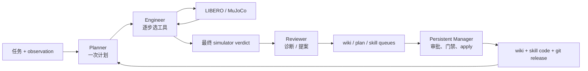
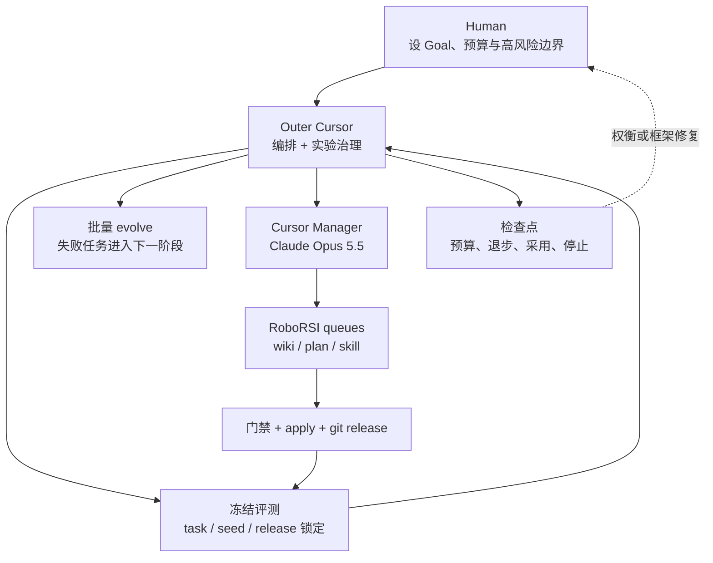
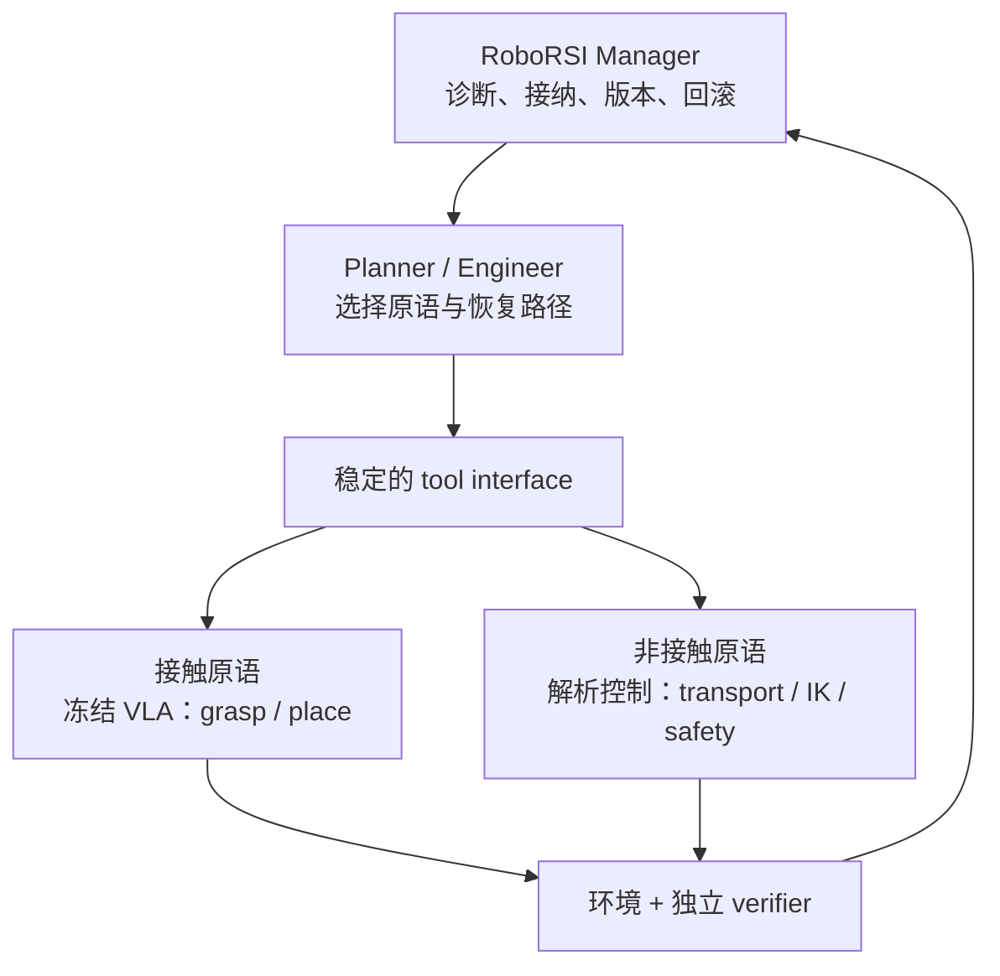

<!--
Suggested front matter for a static-site generator:
title: "我们把 RoboRSI 跑了一轮：11/40 到 17/40，以及 46M tokens 花在哪"
description: "一次固定任务集上的 RoboRSI 闭环验证：失败如何变成 wiki、技能与新 release，分数如何冻结复测，成本又落在哪个角色。"
cover: "images/persistent-manager-rsi-curve-en.png"
-->

# 93.9刀 复现一轮 RoboRSI 的发现

**在固定 40 个 LIBERO-PRO 任务上，RoboRSI 的冻结成功数从 r0 的 11/40 提升到 r1 的 17/40。** 这是一轮完整的 `评测 → 失败进化 → Manager 接纳 → 新 release → 冻结复测`。这次复现验证：**失败能否经过可审计的接纳链，变成一个新 release，并在完全冻结的同一任务集上看到下一版行为发生变化。**

## 学习从模型扩展到执行栈

[RoboRSI](https://github.com/nssmd/RoboRSI) 的核心不是让一个大模型直接输出机器人关节动作，而是把机器人执行拆成两个时间尺度: 

episode 内有三个 role：

1. **Planner** 读取任务与技能文档，生成本次执行计划；
2. **Engineer** 持有仿真 loop，每一步选择一个公开工具并填写参数；
3. **Reviewer** 在 episode 结束后读取 trace，判断最早失败点并提出诊断、plan 或技能候选。

和 episode 外跨 session 持久的 **Manager**。它读取代码、trace 和四类审批队列，拒绝错误诊断，必要时亲自写技能，通过门禁后执行 apply，把结果提交成 git commit。

这里沉淀的能力不只在模型里。它可以停在：

- wiki：哪些失败模式值得 Planner 提前规避；
- seed plan：一类任务的通用执行顺序；
- base skill：可执行、可测试、可版本化的机器人能力；
- release：一组经过 Manager 接纳的 artifact 快照。

这也是 RoboRSI 与普通“反思后重试”的区别。一次对话里想明白了不算继承；只有写入持久 artifact，并在后续冻结运行里被实际读取或调用，才算进入下一版系统。

## 外层 Cursor 编排与治理

上述角色与 artifact 属于 RoboRSI，项目提供单次评测、evolve、队列、apply 和 `roborsi manager` 等组件，但没有一个 controller 自动执行：

`冻结评测 → 选择失败任务 → 批量 evolve → resume Manager → 等队列清空 → 封存 release → 再评测 → 判断停止`

因此还需要一个外层 Agent, e.g. Cursor 会话承担这层编排与治理。实际装置有四层：

外层 Cursor 使用 GPT-5.6 Sol，负责：

- 把 Goal 写成固定任务、验收线、预算与提前停止条件；
- 隔离 r0 / sandbox / r1 的 branch、state 和 seed；
- 在远端启动评测与 evolve，检查日志、失败计数和 token 账单；
- 创建并 resume 独立的 Manager，会话返回后核对 commit、封存 release；
- 用独立 Harness reviewer 检查 plan、任务边界和最终 evidence。

因此，这次结果验证的是 **“RoboRSI 内层进化组件 + Cursor 外层 controller”** 的真实闭环，不是 RoboRSI 项目已经内置全自动多轮 autopilot。Cursor 不是算法必须项；把上面的状态机、预算门和 release 协议实现成项目内 `evolve-loop` controller 后，它可以被普通进程取代。

## 一轮闭环

实验把评测与进化严格分开。

### Baseline r0：先冻结一个能读出变化的基线

我们从 LIBERO-PRO 的 120 个任务中按 12 个扰动族分层锁定 40 个任务，固定 seed 0、pass@1。r0 使用同一个代码 release、全新状态目录，最终成功 11/40。成功只认 episode 结束后的 simulator predicate。Engineer 说“完成”不参与计分；即使模型自信宣布成功，只要环境判定失败，verdict 仍然是 failure。

40 个任务在开跑前被固定分成 4 批，每批 10 个。Batch 只是评测进度，不是进化轮次。每批结束都与 r0 的同一批任务比较。

### Evolution Round 1：从 r0 产生 r1

#### 1. 失败任务进入 evolve

r0 的 29 个失败任务各跑一个 seed 1 的 evolve episode。使用不同 seed，是为了避免直接在冻结验收 seed 上调试。29 个 episode 产生了：

- 22 条 wiki hypothesis；
- 7 条 plan promotion；
- 0 条 Reviewer 技能提案。

#### 2. Manager 接纳并封存 r1

正式 Manager 随后清空队列：

- wiki：批准 2 条，连同门禁 episode 产生的新条目共拒绝 25 条；
- plan：7 条全部拒绝，因为它们都是单场景计划，会覆盖所有任务共用的 seed plan；
- skill：Manager 自己写了 `move_plate_by_rim`，经过 capability 检查与 5 个匹配 episode 后，以 EXPERIMENTAL 合入。

这些改动被封存为 `rsi-mgr-1`。冻结评测开始后，代码、wiki 和技能不再写回；r1 重新跑与 r0 完全相同的 40 个 seed 0 任务。

#### 3. 冻结评测 r1：同一把尺重新量一次

r1 四批分别成功 5、3、4、5 个，累计 17/40。与 r0 的累计差依次是 +2、+3、+6、+6。

最终任务翻转为：

- 新增成功 7 个：`goal_swap/2`、`object_lan/9`、`object_swap/2`、`object_swap/8`、`object_task/9`、
  `spatial_swap/3`、`spatial_task/3`；
- 回退 1 个：`goal_object/1`。

## 真实 rollout 显示了收益，也显示了边界

上排是同一个 `libero_object_swap/8`、同一个 seed 0。任务是把巧克力布丁放进篮子：r0 最终把物体留在篮外，r1 完成了放置。这类任务翻转构成了 11 → 17 的净增。

下排是盘子任务。Manager 新写的 `move_plate_by_rim` 能找到盘沿、进入 `execute`，也能诚实报告失败；但夹爪读数显示 held 时，盘子仍留在原位或在抬升中滑落。

冻结 r1 中，这个技能在 4 个盘子任务里各被调用一次：

- 4 次都是 `grasped=false, placed=false`；
- 4 个任务最终全部失败；
- 7 个新增成功任务没有调用它。

因此，**采用链路已经成立，技能收益没有成立。** r1 的 +6 与 Manager 对 wiki lead、过期规则和路由的整理同时出现，但单臂单遍实验不能证明这些整理就是因果来源。更准确的说法是：一个非空 release 在同一任务集上观察到净增 6，而新技能本身没有贡献可见成功。

## tokens 开销

这里的“一轮完整闭环”包括：

- r0 基线评测：40 episodes，17.15M tokens；
- 29 个主 evolve + 5 个 Manager 门禁 episodes：16.37M tokens；
- r1 冻结评测：40 episodes，12.67M tokens。

合计 114 个 episodes、46.19M tokens、7,030 次计量调用。三个 API role 都使用 `openai/gpt-5.6-sol`：

- Engineer（含工具内部的感知 VLM）：43.83M tokens，占 94.9%，6,802 calls；
- Planner：1.34M，占 2.9%，114 calls；
- Reviewer：1.02M，占 2.2%，114 calls。

Manager 使用 Cursor 中的 Claude Opus 5.5，外层编排使用 Cursor GPT-5.6 Sol。Engineer 占据绝大部分 token 并不意外。Planner 和 Reviewer 每个 episode 各调用一次；Engineer 最多执行 80 步，每步都可能携带增长中的工具历史，并触发额外感知 VLM。

这与 RoboRSI 作者采用的后端分工一致：Engineer 的上下文在单任务内很大，跨任务价值很低，适合一个任务内的无状态 API loop；Planner / Reviewer 更需要跨 run 管理判断，可交给 Claude Code、Codex 等 agent 后端维护会话。为了保持本次实验条件不变，我们的 Planner / Reviewer 也设成了无状态 API 调用，这是相对官方设计的一项偏离。

## 这轮验证可以证明

### 1. 接纳链路能闭合

Manager 写出的技能经过 capability 检查、匹配仿真、正式 apply 和工具表发现，能在后续冻结运行中被 Engineer 选中。
“写了技能但从不调用”这个上一轮实验里的断点已经补上。

### 2. 固定 release 的收益可以被审计

r0、r1 都有独立 tag；同一任务清单、同一 seed、同一成功谓词；评测阶段禁止向 wiki、队列和技能历史写回。
结果可以逐任务追到 verdict 与 trace，而不是只看一个累计覆盖数字。

### 3. Persistent Manager 比脚本替身看到更多系统问题

Manager 不只审批文本。它读代码、核对工具表、运行最小 probe，并在第一轮前定位到普通 IK 请求缺少 `op="ik"`。这个缺陷让普通 IK 静默返回空结果，动作退回容易停滞的 servo。修复进入 r0 后，IK 可达性恢复，但抽屉任务仍暴露碰撞模型与 held 判定问题。这说明代码诊断能找到真实框架缺陷，也说明一个真实缺陷不一定是全部失败的 root cause。

## 这轮验证不能证明

### 1. 没有证明多轮 RSI 曲线

实验只跑了 r0 → r1 一轮。要证明“随着轮次持续提升”，至少还需要 r2、r3 的冻结结果。

### 2. 现有技能更新路径限制了搜索空间

官方 apply 路径对候选执行“只组合公开工具”的安全检查；现有手写 LIBERO 技能普遍 import numpy 或 `_lib`，因此 Reviewer 对 `grasp_object`、`place_*`、`execute_previewed_move` 的更新无法沿同一路径合入。当前闭环更擅长新增组合技能和修改 wiki，却难以修复真正卡住执行的底层技能。

## 下一步：把演化层与执行层接起来

### 当前范式的边界在原语能力

这套装置本质上是 **LLM-as-Policy over tools**：Planner 和 Engineer 能改变计划、工具顺序、参数、重试与恢复，Manager 能把可靠做法写成 wiki 或代码。
它擅长修正“该做什么、何时做、失败后换哪条路”，却不能凭组合创造一个原语本身没有的物理能力。

第一轮已经给出直接证据：`move_plate_by_rim` 5/5 进入 `execute`、没有契约错误，却 0/5 真正抬起盘子；`get_grasp_pose` 30/30 失败，
`visual_pick_place` 14/14 失败，`execute_previewed_move` 33/66 次没有到达目标。继续增加 prompt、wiki lead 或组合技能，只会在坏原语之上搜索更多路径。
现有 apply 门禁又无法更新使用 numpy / `_lib` 的手写 LIBERO 技能，使这条能力边界更难被闭环本身突破。

### RoboRSI 管演化，Harness VLA 管接触执行

[Harness VLA](https://arxiv.org/abs/2607.08448) 提供的不是另一套治理系统，而是另一种原语后端：高层 LLM 仍负责计划与恢复，
冻结 VLA 把抓取、放置等接触动作实现成可重试工具。它与 RoboRSI 位于两个正交层，可以组合：

RoboRSI 保留 wiki、Manager、gate、git release 和冻结评测，继续回答“什么变化可以进入下一版”；Harness VLA 替换最脆弱的接触原语，回答“抓取和放置怎样真正执行”。这比让 VLA 接管全部控制更可审计：运输、位姿调整和安全边界仍由可解释代码负责，VLA 只覆盖解析方法反复失败的接触段。

### 工程收尾

RoboRSI 可以内置一个持有 task set、release、预算和停止条件的 `evolve-loop` 状态机，替代外层 Cursor 的运行时编排。
资源账本应统一记录 API role、cache、Cursor / Claude Code Manager 和外层 controller 的 tokens 与费用。

### 从组合演化走向执行器共演化

当前 RoboRSI 主要演化 orchestrator：经验被写成 wiki、路由、计划与技能组合，底层执行器本身基本不变。Harness VLA 补上了另一半：把跨任务复用的接触能力放进 VLA，使系统不仅学会重新安排已有工具，也能改善工具真正完成物理动作的能力。

两者结合后，长期演化对象不再只是不断增长的技能代码，而是彼此约束的两层系统：RoboRSI 负责从失败中形成知识、决定接纳什么并维护版本；VLA 负责把验证过的交互经验吸收到共享执行能力中。编排层与执行层共同演化，才可能突破“高层越来越聪明，底层原语仍停在原地”的上限。

## 结论

这次实验把 RoboRSI 从“概念上能自进化”推进到一个可审计的单轮事实：

> 同一个固定 40 任务集上，r0 为 11/40；29 个失败进入 evolve，持久 Manager 接纳一组 wiki / skill 改动后封存 r1； r1 为 17/40，净增 6。

最有价值的产出不是 +6 本身，而是边界变清楚了：技能写出来、合进去、被调用，仍然可能 0 收益；wiki 整理与新技能同时变化时，单遍评测无法归因；Engineer 消耗几乎全部 API tokens；真正的底层技能又暂时不在官方更新路径内；完整实验还依赖 RoboRSI 之外的 Cursor controller 才能可靠推进和停止。

RoboRSI 的思想成立在“经验被写回、验证、版本化”这条链上。下一步的关键不是单独把这条链多转几轮，而是让它接上一个能跨过接触瓶颈的执行层：用 Harness VLA 式冻结 VLA 提供通用接触原语，用 RoboRSI 管理诊断、接纳、版本与回滚，再在多轮、独立 lineage 和对照臂下验证它是否持续把物理失败变成稳定能力。

## References

1. [RoboRSI](https://github.com/nssmd/RoboRSI)
2. [LIBERO-PRO](https://github.com/Zxy-MLlab/LIBERO-PRO)
3. [Harness VLA](https://arxiv.org/abs/2607.08448) · [RPent](https://github.com/RLinf/RPent)

## AI usage disclosure

Cursor 中的 GPT-5.6 Sol 负责实验计划、远程编排、预算与检查点、release 封存、证据汇总，读取实验文档、代码路径、campaign manifest
和逐任务 verdict，编写 token 汇总与绘图脚本，提取真实 rollout 帧，并起草、重组和编辑本文。Claude Opus 5.5 在 Cursor 中作为实验的
RoboRSI Manager，负责审批队列、编写候选技能和记录实验决策；
它的判断是本文分析的数据来源之一。文中的场景图来自真实 LIBERO-PRO rollout，曲线与 token 图由脚本从实验记录生成，没有使用 AI 生成图片。

**发布前须由作者逐项核对技术结论、数字、归因边界、链接和图片说明，并按目标发布渠道的 AI 政策调整披露。**
