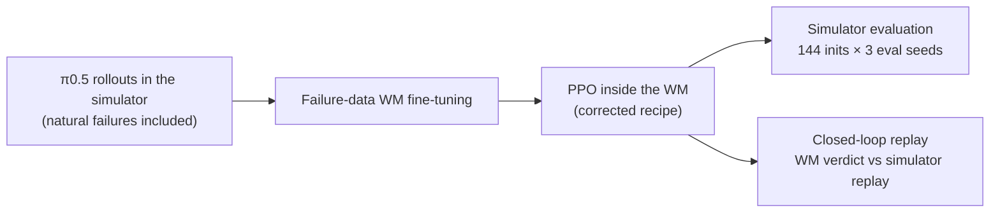
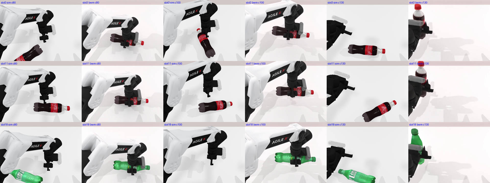
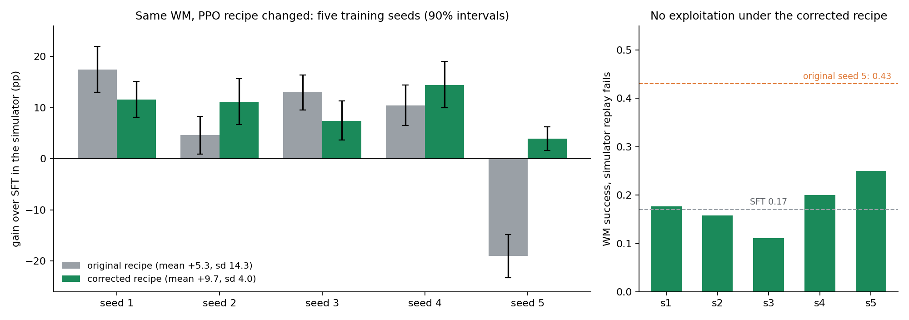
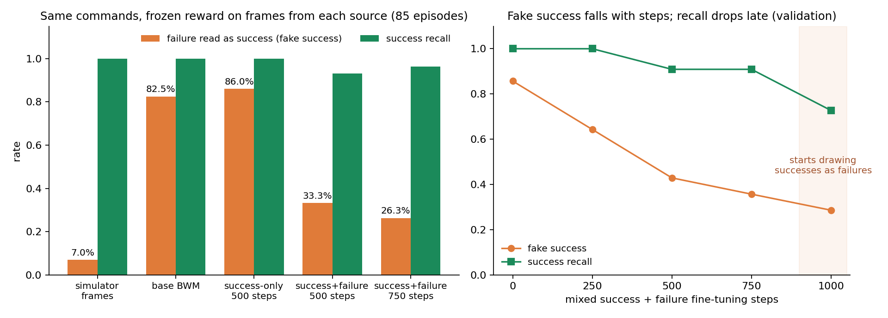
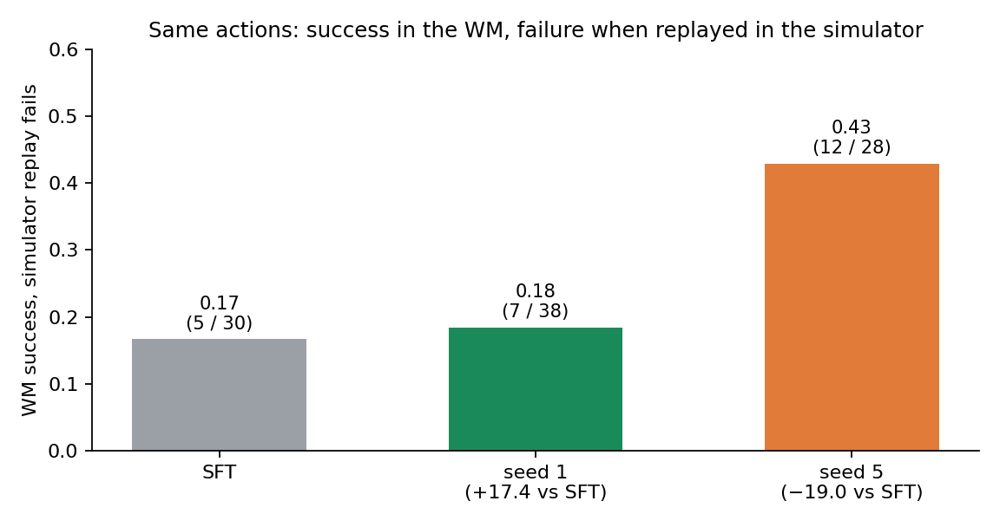
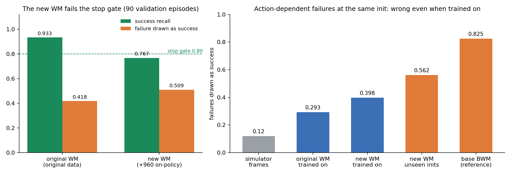

# Learning to Fail: Failure Fidelity and Training Stability for RL inside World Models

> English | [中文](/2026/wmforge-1/learning-to-fail-wm-rl.md)

## Abstract

When a world model (WM) serves as a reinforcement-learning environment, the policy moves toward whatever the WM judges a success, so any systematic tendency of the WM to draw failures as successes gets amplified. On RoboTwin `adjust_bottle`, with the action-conditioned video model BWM as the environment and π0.5 as the policy, this work asks under what conditions in-WM RL gains are reliable. The base BWM draws 82.5% of simulator failures as successes, a gap that pixel metrics barely register. Fine-tuning the WM on the policy's own failure rollouts brings fake success down to 26%; a success-only control does not improve at all. Inside the fine-tuned WM, a PPO recipe that fixes three defects (truncation bootstrapping, where the critic attaches, and the value learning rate) beats SFT significantly on all five training seeds once evaluated back in the simulator: mean gain +9.7 percentage points, standard deviation 4.0. The original recipe had a standard deviation of 14.3 and a worst seed at −19.0. Closed-loop replay shows that the degraded seed under the original recipe was exploiting the WM's fake successes, while the corrected recipe stays at the SFT mismatch level. Ablations locate the remaining error in failures whose outcome depends on action details from a shared initial state: the WM draws 29–40% of them as successes even after training on them, adding on-policy data does not fix this, and these are exactly the states that RL gradients come from.

## 1 Introduction

In a WM used as an RL environment, the policy emits an action chunk, the WM renders the corresponding video, a reward model reads the video and judges success, and the policy updates on that reward. A WM used as a policy evaluator can tolerate errors as long as they hit all policies about equally, because the ranking survives. An RL environment cannot: the policy actively searches for actions that earn reward. If the WM consistently gets a class of actions wrong, for instance drawing a grasp as successful whenever the gripper closes, the policy will take that class of actions more and more often. A WM therefore has to meet a stricter bar as an RL environment than as an evaluator: the outcome of every rollout must be drawn correctly.

Existing in-WM RL work mostly reports single-run training gains, and work on repairing WMs mostly validates prediction quality or ranking. Two questions remain open: whether a repaired WM still judges correctly on the trajectories an updated policy visits, and whether in-WM RL gains reproduce across training seeds.

This work answers both on a single task. Contributions:

- **Measuring outcome fidelity.** The same action sequence drives both the simulator and the WM, and one frozen reward reads both sets of frames, giving the WM's fake-success rate. Closed-loop replay then measures whether an updated policy is exploiting WM errors.
- **Failure-data fine-tuning.** Fine-tuning the WM on the policy's own failure rollouts cuts fake success from 82.5% to 26%, and the effect comes from the failure data itself.
- **Reproducible in-WM PPO.** After three recipe defects are fixed, all five training seeds beat SFT significantly, with mismatch at the SFT level.
- **Locating the remaining error.** Ablations show that the WM's outcome judgments on action forks from a shared initial state remain unreliable and do not respond to more on-policy data. This needs solving before in-WM RL can scale further.

## 2 Related work

**Training VLAs inside world models.** WoVR, WMPO and World-Gymnast post-train VLAs with RL inside action-conditioned video models and report single-run gains of +5 to +29 percentage points. The setup here is closest to WoVR, and the multi-frame history training window follows its recipe. The difference is in validation: every recipe here is trained with five seeds, and closed-loop replay checks whether the policy is exploiting WM errors.

**Optimism bias and failure data.** MiraBench documents the tendency of video WMs to draw failures as successes; none of the 12 models it evaluates solves it. BWM, FACT, 1X and the concurrent CureWM all add failure or counterfactual data to WM training. The failure data here are the policy's own natural failures, and the effect of the repair is traced through to downstream RL gains and mismatch rates. CureWM's same-start counterfactual data targets precisely the action-fork error that remains in Section 5.5.

**PPO for flow-matching VLAs.** πRL runs online RL on π0 / π0.5 and recommends attaching the critic to the VLM output. This work follows that advice and additionally fixes truncation bootstrapping at the episode limit in RLinf's world-model env.

## 3 Method

### 3.1 Setup

| Component | Choice |
|---|---|
| Task | RoboTwin 2.0 `adjust_bottle`, aloha-agilex dual-arm, single head camera |
| Policy | π0.5 SFT checkpoint from WorldArena 2.0 Track 2 |
| WM | [BWM](https://arxiv.org/abs/2607.29302) `step-12000`, an action-conditioned video model on a Wan2.2-TI2V-5B backbone |
| Reward | Frame classifier trained on simulator success labels and then frozen; it scores frames 51–200, takes the peak, and gives a single 1 at step 200 if the peak clears the threshold |
| RL | PPO in RLinf, 96 episodes per step, 10 policy updates |
| Evaluation | Back in the RoboTwin simulator, on 144 initial states sealed before training, three eval seeds per state, paired per state against SFT, with 90% intervals from a per-state bootstrap |

Re-evaluating one policy with a different eval random stream moves its success rate by 1.8 percentage points (standard deviation), far below the cross-seed differences below. SFT scores 0.766 and 0.773 on the two machines used; each comparison is made against SFT on the same machine.

A WM environment has a longer chain than a simulator: action space, frame layout, history noise, reset semantics and termination all have to agree between the WM, the policy and the RL framework. All results here are measured on an aligned interface; Section 5.4 shows what misalignment does.

### 3.2 Failure-data fine-tuning

BWM's RoboTwin training trajectories come from a scripted planner, and only seeds where the planner succeeded were kept. The model has never seen a π0.5-style grasp that closes on air a few centimeters off target, so it draws a lift anyway. The repair changes only the data, not the architecture or the loss:

- **Data**: 677 rollouts in RoboTwin from π0.5 base and several simulator-PPO checkpoints, 165 of them failures. Failures occur naturally, with no scripted perturbation. Success labels are used only for sampling ratios, splits and evaluation, never in the loss.
- **Window**: training and serving share a 61-frame window, 1 initial frame, 8 history frames and 52 future frames, aligned with π0.5's 50-step action chunks.
- **Loss**: clean first frame, lightly noised history frames, flow-matching loss on future frames only. BWM's public training scaffold supports only single-frame conditioning; this step generalizes it to multi-frame history following WoVR.
- **Training**: start from `step-12000`, mix successes and failures, 750 steps.

The repair targets the WM rather than the reward. When the WM draws an error, the frames really do show a successful grasp, so any reward that reads only frames will read a success, and a real WM deployment has no simulator state to fall back on. A frozen classifier's per-frame maximum, a temporal gate requiring k consecutive positive frames, and features built only from action geometry and initial pose all fail to separate success from failure on WM frames.

### 3.3 PPO recipe inside the WM

The corrected recipe changes three things relative to RLinf's default PPO:

- **Report termination at the episode limit.** WM episodes always end at step 200 and the reward is an episode-level 0/1, yet the env reports step 200 as truncation. The standard treatment adds γ·V(s_T) to the last reward on the assumption that the episode would continue; with γ = 1, the critic's target becomes "reward plus its own estimate", and returns drift with the value. The fix makes the world-model env report termination at `max_episode_steps`. It has been added to RLinf's world-model env as an off-by-default option and is being prepared for upstream.
- **Attach the critic to the VLM output and warm it up.** Following πRL's advice for π0.5, the critic reads the VLM output instead of the action expert, whose inputs are mixed with noised actions. The first 4 training steps train only the critic and the next 10 update jointly, so the number of policy updates matches the original recipe.
- **Cut the value learning rate by 10×.** At the original rate, about half of the critic updates exceed the value clip.

### 3.4 Closed-loop replay mismatch

The fake-success rate is measured on SFT's recorded actions, so it cannot see whether an updated policy has moved into regions where the WM draws wrong outcomes. Closed-loop replay fills that gap: a checkpoint generates actions closed-loop inside the WM and its WM verdicts are recorded; the action sequences the WM judged successful are then replayed unchanged in the simulator from the same initial state. The mismatch rate is the fraction of those replays that fail, compared against SFT's mismatch rate. A rate well above SFT means the policy is exploiting WM errors.

## 4 Main results

### 4.1 Failure-data fine-tuning repairs coarse fake success

Driving the base BWM open-loop with the actions of simulator failures, 3 of 4 failed grasps are drawn as grasped and set upright:

*Figure 1: three simulator failures (one per row) at commands 80, 100 and 130; at each time step the left frame is the simulator and the right is BWM. In the simulator the gripper misses or knocks the bottle over and the bottle ends up lying on the table; given the same commands, BWM draws the bottle being held, lifted and set upright.*

On 85 episodes (57 failures, 28 successes), the same commands go to both the simulator and the WM, and the same frozen reward reads both sets of frames:

| Frame source | Failure read as success | Success recall |
|---|---:|---:|
| Simulator frames | 0.07 | 1.00 |
| Base BWM `step-12000` | 0.825 | 1.00 |
| Failure-data fine-tuning, 750 steps | **0.263** | 0.964 |

The reward is accurate on both sides for simulator frames; the error is in the WM frames. Pixel metrics do not show the gap: the base BWM's PSNR on failures is only about 1 dB below its PSNR on successes, while 82.5% of failures come out as successes. After fine-tuning, fake success drops to 26.3% with success recall at 0.96.

### 4.2 Under the corrected recipe, in-WM PPO beats SFT across training seeds

Inside the fine-tuned WM, the original and corrected recipes are each trained with five seeds, everything else equal. The criterion was frozen before the runs: all five gains over SFT above 0, every 90% lower bound above 0, and cross-run standard deviation below 7 percentage points.

*Figure 2: left, gain over SFT in the simulator for five training seeds of each recipe in the same WM, with 90% intervals from a per-state bootstrap; right, closed-loop replay mismatch for each corrected-recipe run, with SFT and original-recipe seed 5 as dashed lines.*

| Seed | 1 | 2 | 3 | 4 | 5 | Mean | SD |
|---|---:|---:|---:|---:|---:|---:|---:|
| Original recipe (pp) | +17.4 | +4.6 | +13.0 | +10.4 | −19.0 | +5.3 | 14.3 |
| Corrected recipe (pp) | +11.6 | +11.1 | +7.4 | +14.4 | +3.9 | **+9.7** | **4.0** |
| Corrected-recipe mismatch | 0.18 | 0.16 | 0.11 | 0.20 | 0.25 | | |

All five corrected-recipe runs pass the criterion, with a one-sided 95% lower bound of +5.8; even the weakest, seed 5, gains +3.9 with its interval above 0. The original recipe's mean interval is [−8.4, +18.9], which crosses zero. Corrected-recipe mismatch ranges from 0.11 to 0.25, the same level as SFT's 0.17. The WM's training-time success rate moves with the simulator gain: seed 3 has the lowest training-time rate (0.48–0.66) and the smallest gain, while seed 4 has the highest rate over its last two steps (0.89, 0.90) and the largest gain. The five seeds took about 43 hours on 8 MI300X GPUs.

## 5 Ablations and analysis

### 5.1 Failure data does the work, not training steps

*Figure 3: left, the frozen reward on frames from each source for the same commands (57 failures, 28 successes); right, fake success and success recall against mixed fine-tuning steps (validation split, 28 failures, 11 successes).*

At the same 500 steps, the success-only control has 86% fake success, worse than the base BWM, while the mixed recipe has 33%. Clustered by initial state, 11 of 14 failure states get worse under success-only training and none get better. Both recipes improve PSNR over the base BWM by about 2 dB, so pixel metrics cannot tell them apart either.

Training steps have a ceiling. At 1000 steps, validation fake success falls to 0.286 but success recall falls to 0.73 as the model starts drawing successes as failures. Fake success and recall have to be read together; looking only at the former mistakes a WM that has become pessimistic overall for a repaired one.

### 5.2 The degraded seed under the original recipe exploits WM fake successes

Original-recipe seed 5's −19.0 in Figure 2 has two possible sources: PPO updating unstably on a correct signal, or the policy moving into regions where the WM draws wrong outcomes. Closed-loop replay separates the two:

*Figure 4: under the original recipe, the fraction of WM-success episodes on 24 initial states that fail when replayed in the simulator.*

Of the 28 episodes original-recipe seed 5 succeeds at inside the WM, 12 fail in simulator replay (0.43). SFT is at 5/30 (0.17), an excess mismatch of +0.26 with a 90% interval of [+0.08, +0.43]. The best seed, seed 1, is at 0.18, no different from SFT. The frozen reward reads every one of these "WM success, simulator failure" replays as a failure, so the error lies in what the WM generates. None of the five corrected-recipe runs shows this mismatch (Figure 2, right); their updates were not steered toward WM errors.

A critic-free group-baseline variant reaches +11.1 and +4.2 on two seeds, no more stable than the original recipe; cross-seed variance does not go away just by bypassing the critic.

### 5.3 Effect of the recipe components on the critic

Under the original recipe, the critic's explained variance never exceeds 0.13 and stays negative in some runs. Splitting the success variance from simulator re-evaluation into between-state and within-state parts, the between-state share is about 0.6–0.8. That is the ceiling for a perfect critic that sees only the initial state, so the critic has enough signal to learn from. Adding the fixes one at a time and reading the median explained variance over 24 training steps:

| Configuration | Median explained variance | Observation |
|---|---:|---|
| + critic on VLM, 4-step warmup | −0.138 | About half the updates exceed the value clip |
| + value learning rate ÷ 10 | −0.038 | Clipping is under control, but returns chase the value: 0/1 rewards produce returns up to 2.25 |
| + termination at the episode limit | −0.016 | The drift disappears; the critic learns only the mean return |

Under the corrected recipe the critic still learns only the mean, and its explained variance stays near 0 in all five final runs. A linear probe on the critic's inputs recovers success with R² 0.283, so the information is present but online training does not extract it. The corrected recipe's stability therefore does not come from a more accurate critic; the contribution of each of the three fixes to simulator gains has not been ablated individually.

### 5.4 Interface-contract errors alone are enough to make in-WM RL regress

With three interface errors in place (the two arms' action blocks swapped; the WM echoing the previous command rather than the initial state on reset; the episode ending at the first positive reward), PPO inside the base BWM drops simulator success from 93/144 to 64/144, while PPO run directly in the simulator goes from 93/144 to 114/144. With the interface fixed, three single runs inside the base BWM land at −4.9, +5.6 and +16.0 percentage points against SFT, with no systematic regression. A negative in-WM RL result cannot be attributed to the WM until interface errors have been ruled out.

### 5.5 More on-policy data does not fix action forks

Section 5.2 points to a direct fix: add the updated policies' trajectories, with simulator labels, to WM fine-tuning. The five original-recipe checkpoints are run 4 times each on 48 training initial states, giving 960 trajectories (167 failures). These are merged with the 677 from Section 3.2 and the WM is retrained from `step-12000` for 750 steps with the same recipe, data being the only variable. A stop gate was frozen in advance: validation success recall below 0.80 counts as failure.

*Figure 5: left, success recall and fake success on the same validation split before and after adding data; right, the fraction of failures drawn as success for several groups. "Trained on" means the failure trajectories themselves are in the WM's training set, mostly from initial states that produce both outcomes; "simulator frames" are the simulator's own frames for the same failures; "unseen inits" are validation failures.*

The new WM's success recall falls from 0.933 to 0.767, failing the stop gate, and fake success rises from 0.418 to 0.509. Training steps are not the cause: discrimination (recall minus fake success) peaks at 500 steps and then declines. All of the new data's initial states were already in the original training set, 85% of repeated runs of the same policy on the same state give the same outcome, and 45% of the failures come from the degraded seed 5.

The right panel of Figure 5 shows the deeper cause. In the added data, outcomes from a shared initial state mostly depend on the actions: only 32% of initial states have a single outcome, against 71% in the original training set. On these failures, even when the trajectories themselves are in the training set, the original WM still draws 29% as successes and the new WM 40%, versus 12% for the simulator's own frames; on unseen initial states the new WM is at 56%. Failure data repairs coarse failures that are determined by the initial state; failures decided by action details do not come down with more data or more steps. Whether the WM has not learned the action fork or open-loop generation drifts further and further off cannot be separated with the current data.

## 6 Discussion and limitations

The results split the reliability of in-WM RL into two layers. The first is the training recipe: on the same WM, recipe defects alone take the cross-seed standard deviation from 4.0 to 14.3 and let individual seeds exploit WM errors. A single-run gain says little about whether a WM is usable; validation needs at least multiple training seeds and a closed-loop replay mismatch check. The second layer is the WM's outcome fidelity: failure data repairs coarse fake success, but action forks from a shared initial state are still drawn wrong 29–40% of the time.

The second layer matters more as training scales. RL gradients come from initial states with mixed outcomes: when all rollouts from a state succeed or all fail, the group advantage is roughly zero. WM fake successes concentrate in exactly those states. Within the 10-policy-update budget used here, the corrected recipe is not dragged down by them; longer training and larger group baselines will concentrate gradients further on these states, and action-fork fidelity will likely set the ceiling on in-WM RL gains. Two directions can be tested directly: admit WMs by comparing WM and simulator verdicts on updated-policy trajectories from mixed-outcome initial states, and train WMs on paired counterfactuals from the same start (the nominal action and a perturbed action that fails), which is the direction CureWM takes. More rollouts per step reduce gradient variance without changing WM bias; from the corrected recipe's cross-seed variance, the expected gain is about 0–3 percentage points, below the roughly 4 points that five seeds can detect, and it was not run.

Limitations:

- One task, one policy, one WM, and only 10 policy updates per run; whether the conclusions hold across tasks or for longer training is unknown.
- The three changes in the corrected recipe have not been ablated individually against simulator gains.
- The new WM in Section 5.5 was trained once with a single generation seed; closed-loop replay covers only 24 initial states per checkpoint.
- For a few initial states the outcome depends on state invisible in the WM's inputs (sub-pixel perturbations flip it), so the simulator ground truth itself is unstable there.

## Data and weights

- The 677 π0.5 rollouts from Section 3.2 (165 failures, with simulator success labels): [lidavidsh/robotwin-adjust-bottle-pi05-rollouts](https://huggingface.co/datasets/lidavidsh/robotwin-adjust-bottle-pi05-rollouts)
- BWM weights after 750 steps of failure-data fine-tuning (the RL environment of Section 4.2): [lidavidsh/bwm-robotwin-adjust-bottle-failure-ft](https://huggingface.co/lidavidsh/bwm-robotwin-adjust-bottle-failure-ft)

## AI usage

Experiment execution, log analysis and the first draft of this post were done with AI coding assistants (Claude in Cursor, with Codex for design and result review); the experimental trade-offs, the conclusions and the edits before publication are the author's. Figures are plotted by scripts from experiment readouts or captured from experiment frames; none are AI-generated. Experiments ran on AMD MI300X.

## References

- Boundless World Model (BWM). [arXiv:2607.29302](https://arxiv.org/abs/2607.29302) · [GitHub](https://github.com/boundless-large-model/boundless-world-model)
- WorldArena 2.0. [arXiv:2605.17912](https://arxiv.org/abs/2605.17912) · [GitHub](https://github.com/WorldArena2/WorldArena-2.0)
- WoVR: World Models as Reliable Simulators for Post-Training VLA Policies with RL. [arXiv:2602.13977](https://arxiv.org/abs/2602.13977)
- WMPO. [GitHub](https://github.com/WM-PO/WMPO)
- World-Gymnast. [arXiv:2602.02454](https://arxiv.org/abs/2602.02454)
- MiraBench. [arXiv:2605.29360](https://arxiv.org/abs/2605.29360)
- FACT. [arXiv:2608.10232](https://arxiv.org/abs/2608.10232)
- 1X World Model. [Technical report](https://www.1x.tech/1x-world-model.pdf)
- CureWM: World Models Dream of Success. [arXiv:2610.09134](https://arxiv.org/abs/2610.09134)
- πRL. [arXiv:2510.25889](https://arxiv.org/abs/2510.25889)
- RLinf. [GitHub](https://github.com/RLinf/RLinf)
