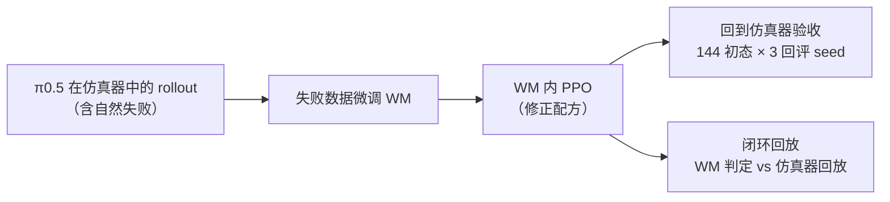
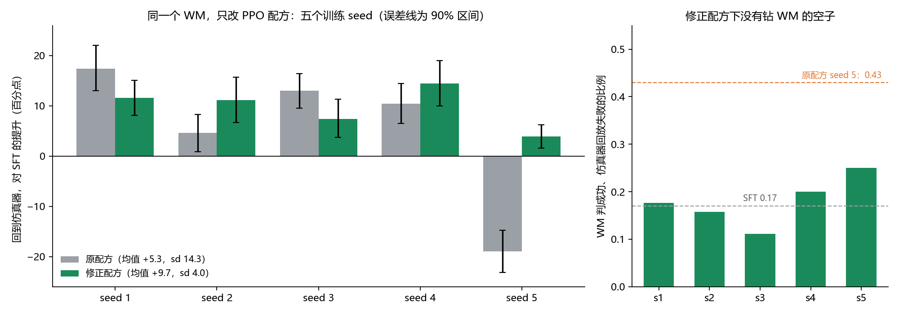
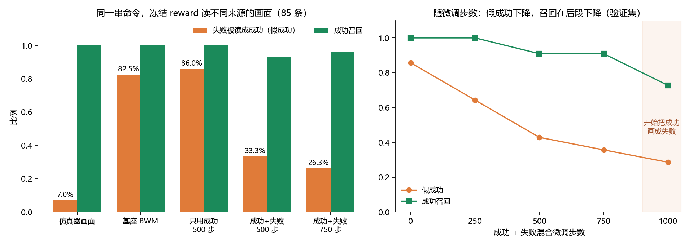
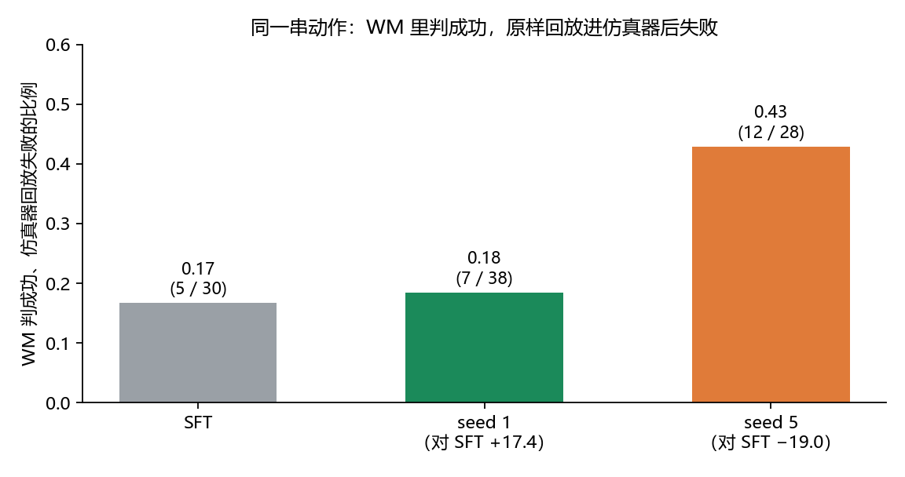
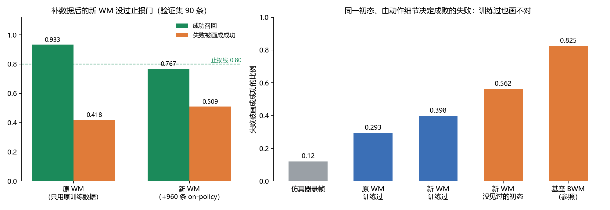

# 学会失败的世界模型：WM 内强化学习的失败保真度与训练稳定性

> [English](/2026/wmforge-1/learning-to-fail-wm-rl-en.md) | 中文

## 摘要

世界模型（WM）当强化学习环境时，policy 会朝 WM 判为成功的方向更新，WM 把失败画成成功的系统误差因此会被放大。本文在 RoboTwin `adjust_bottle` 上，以动作条件视频模型 BWM 作环境、π0.5 作 policy，研究 WM 内 RL 的收益在什么条件下可靠。原生 BWM 把 82.5% 的仿真器失败画成成功，像素指标几乎看不出这一点。用 policy 自己的失败轨迹微调 WM，假成功降到 26%，只用成功数据的对照没有改善。在微调后的 WM 里，修正截断自举、critic 接法与 value 学习率三处缺陷的 PPO 配方，五个训练 seed 回到仿真器全部显著好于 SFT，平均提升 +9.7 个百分点、标准差 4.0；原配方的标准差是 14.3，最差 seed 为 −19.0。闭环回放显示，原配方的退化 seed 在利用 WM 的假成功，修正配方的失配率与 SFT 持平。消融与分析表明，剩余误差集中在同一初态下由动作细节决定成败的失败上：这类失败 WM 训练过也有 29–40% 画成成功，补充 on-policy 数据不能修复；而 RL 的梯度恰好来自这类初态。

## 1 引言

WM 当 RL 环境时，policy 每输出一段动作，WM 生成对应的一段视频，reward 读这段视频判断成败，policy 再按 reward 更新。WM 当策略评估器时，只要误差对各个策略差不多，排序就不会错；当 RL 环境则不同，policy 会主动寻找拿到 reward 的动作。如果 WM 在某类动作上固定出错，比如夹爪一合就画成抓住，policy 就会越来越多地走这类动作。WM 当 RL 环境的要求因此比当评估器更严：每条 rollout 的结局都要画对。

已有的 WM 内 RL 工作报告的多是单次训练增益，WM 的修复工作验证的多是预测质量或排序。两个问题因此还没有回答：修复后的 WM 在 policy 更新后访问的轨迹上是否仍然判得对，以及 WM 内 RL 的增益跨训练 seed 是否可复现。

本文在一个任务上回答这两个问题，贡献如下：

- **结局保真度的度量。** 用同一串动作分别驱动仿真器与 WM，用同一个冻结 reward 读两边画面，得到 WM 的假成功率；再用闭环回放度量更新后的 policy 是否在利用 WM 的错误。
- **失败数据微调。** 用 policy 自己的失败轨迹微调 WM，假成功从 82.5% 降到 26%，作用来自失败数据本身。
- **可复现的 WM 内 PPO。** 修正三处配方缺陷后，五个训练 seed 全部显著好于 SFT，失配率保持在 SFT 水平。
- **剩余误差的定位。** 消融显示，WM 对同一初态下动作分叉的结局判断仍不可靠，且补 on-policy 数据修不动，这是 WM 内 RL 进一步扩展前要解决的问题。

## 2 相关工作

**WM 内训练 VLA。** WoVR、WMPO、World-Gymnast 在动作条件视频模型里用 RL 后训练 VLA，报告了单次运行 +5 到 +29 个百分点的增益。本文的设置与 WoVR 最接近，多帧 history 的训练窗口也沿用其做法；区别在于验收：本文对每个配方训练五个 seed，并用闭环回放检查 policy 是否在利用 WM 的错误。

**WM 的乐观偏差与失败数据。** MiraBench 记录了视频 WM 把失败画成成功的倾向，评测的 12 个模型都没有解决。BWM、FACT、1X 以及同期的 CureWM 都把失败数据或反事实数据加进 WM 训练。本文的失败数据来自 policy 自己的自然失败，并把修复的效果追到下游 RL 收益与失配率上；CureWM 的同起点反事实数据针对的正是本文 5.5 节剩下的动作分叉误差。

**flow-matching VLA 的 PPO。** πRL 在 π0 / π0.5 上做在线 RL，建议 critic 接在 VLM 输出上；本文沿用这一点，并在 RLinf 的 world-model env 上修正了 episode 上限处的截断自举。

## 3 方法

### 3.1 设置

| 组件 | 选择 |
|---|---|
| 任务 | RoboTwin 2.0 `adjust_bottle`，aloha-agilex 双臂，单头相机 |
| policy | WorldArena 2.0 Track 2 的 π0.5 SFT checkpoint |
| WM | [BWM](https://arxiv.org/abs/2607.29302) `step-12000`，Wan2.2-TI2V-5B 骨干的动作条件视频模型 |
| reward | 用仿真器成功标签训练后冻结的帧判别器，第 51–200 帧逐帧打分取峰值，过阈值在第 200 步给一次 1 |
| RL | RLinf 上的 PPO，每步 96 条 episode，10 次 policy 更新 |
| 验收 | 回到 RoboTwin 仿真器，在开跑前封存的 144 个初态上、每个初态三组回评 seed，与 SFT 逐初态配对，按初态 bootstrap 得 90% 区间 |

同一个 policy 换回评随机流，成功率的标准差是 1.8 个百分点，远小于下文的跨 seed 差异。SFT 的成功率在两台机器上分别为 0.766 与 0.773，每组对比只与同一台机器上的 SFT 比较。

WM 当环境的链路比仿真器长，动作空间、帧布局、history 噪声、reset 语义、终止条件都要与 policy 和 RL 框架对齐。本文所有结果都在对齐后的接口上测得，接口错误的影响见 5.4 节。

### 3.2 失败数据微调

BWM 的 RoboTwin 训练轨迹来自规划器采集，只保留规划器成功的 seed。π0.5 那种差几厘米就合空的动作它没见过，就照样画成提起。修复只动数据，不改架构和 loss：

- **数据**：π0.5 base 与几个仿真器 PPO checkpoint 在 RoboTwin 里的 rollout，共 677 条，其中失败 165 条。失败自然产生，不靠脚本扰动。成败标签只用于抽样配比、切分和验收，不进 loss。
- **窗口**：训练与服务统一为 61 帧，即 1 帧初始画面、8 帧 history、52 帧未来，对齐 π0.5 每段 50 步的动作块。
- **loss**：首帧干净，history 帧轻度加噪，只在未来帧上算 flow-matching loss。BWM 公开的训练骨架只支持单帧条件，这一步按 WoVR 的做法泛化到多帧 history。
- **训练**：从 `step-12000` 起训，成功与失败混合，750 步。

修正落在 WM 上，而不是更换 reward：WM 画错时，画面里本来就是「抓住了」，任何只看画面的 reward 都会读到成功，真正的 WM 部署场景里也没有仿真器状态可借。冻结判别器的逐帧最大值、连续 k 帧判阳的时序门、只用动作几何与初态位姿的特征，都分不开 WM 画面上的成败。

### 3.3 WM 内 PPO 配方

修正配方相对 RLinf 的默认 PPO 做三处改动：

- **在 episode 上限处报告终止。** WM episode 固定在第 200 步结束，奖励是 episode 级的 0/1，但环境把第 200 步报告为截断（truncation）。标准处理会在最后一个奖励上加 γ·V(s_T)，假定 episode 还会继续；在 γ = 1 时，critic 的目标变成「奖励 + 自己的估值」，回报会随 value 漂移。修正让 world-model env 在 `max_episode_steps` 处报告终止，已作为默认关闭的选项加进 RLinf 的 world-model env，准备提交上游。
- **critic 接 VLM 输出并预热。** 按 πRL 对 π0.5 的建议，critic 接在 VLM 输出上，不接混着加噪动作的 action expert；前 4 个训练步只训 critic，之后 10 步联合更新，policy 更新次数与原配方相同。
- **value 学习率降为 1/10。** 原学习率下约一半的 critic 更新越过 value clip。

### 3.4 闭环回放失配率

假成功率测在 SFT 的录制动作上，测不到更新后的 policy 是否走到了 WM 会画错的地方。闭环回放补上这一点：让某个 checkpoint 在 WM 里闭环生成动作并记下 WM 的判定，再把 WM 判为成功的动作序列在仿真器同一初态上原样回放。失配率是其中回放失败的比例，与 SFT 的失配率比较；明显高于 SFT，说明这个 policy 在利用 WM 的错误。

## 4 主结果

### 4.1 失败数据微调修复了粗粒度假成功

用仿真器里失败的那组动作原样开环驱动原生 BWM，4 条失败抓取里有 3 条被画成抓住并扶正：

*图 1：三条仿真器失败样本（每行一条）在第 80、100、130 条命令时的画面，每个时刻左为仿真器、右为 BWM。仿真器里夹爪落空或把瓶子碰倒，瓶子最终横躺在桌上；BWM 收到同一串命令，画出瓶子被握持、离桌并扶正。*

在 85 条 episode（57 条失败、28 条成功）上，把同一串命令分别交给仿真器和 WM，用同一个冻结 reward 读两边的画面：

| 画面来源 | 失败被读成成功 | 成功召回 |
|---|---:|---:|
| 仿真器自己的画面 | 0.07 | 1.00 |
| 原生 BWM `step-12000` | 0.825 | 1.00 |
| 失败数据微调 750 步 | **0.263** | 0.964 |

reward 在仿真器画面上两侧都准，错误出在 WM 画面上。像素指标看不出这层差别：原生 BWM 在失败侧的 PSNR 只比成功侧低约 1 dB，结果层却有 82.5% 的假成功。微调后假成功降到 26.3%，成功召回保持 0.96。

### 4.2 修正配方下，WM 内 PPO 跨训练 seed 稳定好于 SFT

在微调后的 WM 里，原配方与修正配方各训五个训练 seed，其余设置相同。判据在开跑前冻结：五个 run 对 SFT 的提升都大于 0、各自 90% 区间下界都大于 0、跨 run 标准差小于 7 个百分点。

*图 2：左，同一个 WM 里原配方与修正配方各五个训练 seed，回到仿真器相对 SFT 的提升，误差线为按初态 bootstrap 的 90% 区间；右，修正配方下每个 run 的闭环回放失配率，虚线为 SFT 与原配方 seed 5。*

| seed | 1 | 2 | 3 | 4 | 5 | 均值 | 标准差 |
|---|---:|---:|---:|---:|---:|---:|---:|
| 原配方（百分点） | +17.4 | +4.6 | +13.0 | +10.4 | −19.0 | +5.3 | 14.3 |
| 修正配方（百分点） | +11.6 | +11.1 | +7.4 | +14.4 | +3.9 | **+9.7** | **4.0** |
| 修正配方失配率 | 0.18 | 0.16 | 0.11 | 0.20 | 0.25 | | |

修正配方的五个 run 全部过判据，单侧 95% 下界 +5.8，最差的 seed 5 也有 +3.9 且区间下界大于 0。原配方的均值区间是 [−8.4, +18.9]，跨零。修正配方的失配率在 0.11–0.25，与 SFT 的 0.17 同一水平。训练期 WM 判定的成功率与仿真器收益同向：seed 3 训练期最低（0.48–0.66），收益也最小；seed 4 末两步最高（0.89、0.90），收益也最大。五个 seed 在 8 张 MI300X 上共约 43 小时。

## 5 消融与分析

### 5.1 起作用的是失败数据，不是训练步数

*图 3：左，同一串命令下冻结 reward 读不同来源画面的结果（57 条失败、28 条成功）；右，混合微调步数与假成功、成功召回的关系（验证集，28 条失败、11 条成功）。*

同样训练 500 步，只用成功数据的对照假成功是 86%，比原生 BWM 还高；成功与失败混合是 33%。按初态聚类，14 个失败初态中有 11 个在成功-only 配方下更差，0 个更好。两种配方的 PSNR 都比原生 BWM 高约 2 dB，像素指标同样分不开它们。

训练步数有上限。继续训到 1000 步，验证集上的假成功降到 0.286，成功召回也掉到 0.73，模型开始把成功画成失败。假成功与召回要同时看，只看前者会把「整体变悲观」误读成修复。

### 5.2 原配方的退化 seed 在利用 WM 的假成功

图 2 中原配方 seed 5 的 −19.0 有两种可能的来源：PPO 在正确的信号上更新得不稳，或者 policy 走到了 WM 会画错的区域。闭环回放区分了这两者：

*图 4：原配方下，24 个初态上 WM 判成功的 episode 回放进仿真器后失败的比例。*

原配方 seed 5 在 WM 里判成功的 28 条 episode，回放进仿真器有 12 条失败（0.43）；SFT 是 5/30（0.17），额外失配 +0.26，90% 区间 [+0.08, +0.43]。最好的 seed 1 是 0.18，与 SFT 没有差别。这些「WM 判成功、仿真器失败」的回放画面，冻结 reward 全部判为失败，错误出在 WM 的生成上。修正配方下五个 run 都没有出现这种失配（图 2 右），policy 的更新没有被引向 WM 的错误。

去掉 critic 的组基线方案在两个 seed 上是 +11.1 和 +4.2，不比原配方更稳，跨 seed 方差不能单靠绕开 critic 消除。

### 5.3 配方各组件对 critic 的影响

原配方下 critic 的 explained variance 都不超过 0.13，部分运行持续为负。把仿真器重评的成败方差拆成「初态之间」与「同一初态内」，前者的占比约 0.6–0.8，是只看初态的完美 critic 能达到的上限，critic 有足够的信号可学。逐项加入修正，在 24 个训练步内看 explained variance 的中位数：

| 配置 | explained variance 中位数 | 现象 |
|---|---:|---|
| + critic 接 VLM、预热 4 步 | −0.138 | 约一半的更新越过 value clip |
| + value 学习率降为 1/10 | −0.038 | 越界压住，但回报追着 value 漂：0/1 奖励下回报到 2.25 |
| + episode 上限处报告终止 | −0.016 | 漂移消失，critic 只学到回报均值 |

修正配方下 critic 仍只学到均值，在五个正式 run 里 explained variance 也贴近 0。对 critic 输入做线性探针，成败的 R² 为 0.283，输入里有成败信息，在线训练没有学出来。修正配方的稳定因此不来自更准的 critic；三处修正各自对仿真器收益的贡献没有逐项消融。

### 5.4 接口契约错误足以让 WM 内 RL 退化

在三处接口错误下（双臂动作块顺序反了；reset 时 WM 回显上一条命令而不是初始状态；奖励在第一次判阳时就终止 episode），原生 BWM 内 PPO 回到仿真器后成功率从 93/144 掉到 64/144；同期仿真器内 PPO 是 93/144 → 114/144。修正接口后，原生 BWM 内三次单次运行相对 SFT 是 −4.9、+5.6、+16.0 个百分点，没有系统性退化。WM 内 RL 的负结果在排除接口错误之前不能归因到 WM 本身。

### 5.5 补充 on-policy 数据不能修复动作分叉

5.2 节的发现指向一个直接的修法：把更新后 policy 的轨迹带着仿真器标签补进 WM 微调。用原配方的五个 checkpoint 在 48 个训练初态上各跑 4 遍，得到 960 条轨迹（失败 167 条），与 3.2 节的 677 条合并，按同一配方从 `step-12000` 重训 750 步，唯一变量是数据。止损门在开跑前冻结：验证集成功召回低于 0.80 即判为失败。

*图 5：左，补数据前后的 WM 在同一验证集上的成功召回与假成功；右，几类失败被画成成功的比例。「训练过」指这批失败轨迹本身在 WM 的训练集里，且多落在同一初态下成败并存的初态上；「仿真器录帧」是同一批失败的仿真器画面；「没见过的初态」是验证集里的失败。*

新 WM 的成功召回从 0.933 掉到 0.767，没过止损门；假成功从 0.418 升到 0.509。训练步数不是原因，区分度（召回减假成功）在 500 步到顶后回落。这批数据的初态都已在原训练集里，同一 policy、同一初态多跑一遍有 85% 结果不变，失败有 45% 来自退化的 seed 5。

图 5 右侧给出更根本的原因。补充数据里同一初态的成败多取决于动作：只有 32% 的初态结果唯一，原训练集是 71%。在这类失败上，即使轨迹本身就在训练集里，原 WM 仍把 29% 画成成功，新 WM 是 40%，仿真器录帧只有 12%；新 WM 在没见过的初态上是 56%。失败数据修掉的是由初态决定的粗粒度失败，由动作细节决定成败的失败，补数据、加步数都降不下去。这些失败是 WM 没学会动作分叉，还是开环生成越画越偏，现有数据分不开。

## 6 讨论与局限

结果把 WM 内 RL 的可靠性拆成了两层。第一层是训练配方：在同一个 WM 上，配方缺陷就能让跨 seed 标准差从 4.0 变成 14.3，并让个别 seed 去利用 WM 的错误；单次运行的增益不能代表 WM 的可用性，验收至少要包含多个训练 seed 与闭环回放失配。第二层是 WM 的结局保真度：失败数据能修复粗粒度的假成功，但同一初态下的动作分叉仍有 29–40% 画错。

第二层在更大规模的训练里会更关键。RL 的梯度来自成败混合的初态：一个初态下 rollout 全成或全败，组内 advantage 约为 0。WM 的假成功恰好集中在同一类初态上。在本文 10 次 policy 更新的预算下，修正配方没有被它拖垮；更长的训练、更大的组基线会把梯度进一步集中到这些初态上，动作分叉的保真度很可能决定 WM 内 RL 收益的上限。两个方向可以直接检验：WM 的准入改为在成败混合初态上，用更新后 policy 的轨迹比较 WM 与仿真器的判定；用同一起点的成对反事实数据（名义动作与会失败的偏移动作）训练 WM，CureWM 走的是这个方向。每步更多 rollout 只降低梯度方差、不改变 WM 偏差，按修正配方的跨 seed 方差估算收益约 0–3 个百分点，低于五个 seed 能检出的约 4 个百分点，本文没有测。

局限：

- 一个任务、一个 policy、一个 WM，每次训练只有 10 次 policy 更新；结论是否跨任务、跨更长训练成立未知。
- 修正配方的三处改动没有逐项对仿真器收益做消融。
- 5.5 节的新 WM 只训了一次、只用一个生成 seed；闭环回放每个 checkpoint 只覆盖 24 个初态。
- 少数初态的成败由 WM 输入里看不到的状态决定（亚像素扰动即可翻转），仿真器真值在这些初态上本身就不稳定。

## 数据与权重

- 3.2 节的 677 条 π0.5 rollout（含 165 条失败，带仿真器成败标签）：[lidavidsh/robotwin-adjust-bottle-pi05-rollouts](https://huggingface.co/datasets/lidavidsh/robotwin-adjust-bottle-pi05-rollouts)
- 失败数据微调 750 步的 BWM 权重（4.2 节的 RL 环境）：[lidavidsh/bwm-robotwin-adjust-bottle-failure-ft](https://huggingface.co/lidavidsh/bwm-robotwin-adjust-bottle-failure-ft)

## AI 使用说明

实验的执行驱动、日志分析与本文初稿由 AI 编程助手（Cursor 中的 Claude，设计与结果评审用 Codex）完成，实验设计的取舍、结论与发布前的删改由作者负责。文中图表由脚本从实验读数绘制或截取自实验画面，没有 AI 生成的图片。实验在 AMD MI300X 上完成。

## References

- Boundless World Model（BWM）. [arXiv:2607.29302](https://arxiv.org/abs/2607.29302) · [GitHub](https://github.com/boundless-large-model/boundless-world-model)
- WorldArena 2.0. [arXiv:2605.17912](https://arxiv.org/abs/2605.17912) · [GitHub](https://github.com/WorldArena2/WorldArena-2.0)
- WoVR: World Models as Reliable Simulators for Post-Training VLA Policies with RL. [arXiv:2602.13977](https://arxiv.org/abs/2602.13977)
- WMPO. [GitHub](https://github.com/WM-PO/WMPO)
- World-Gymnast. [arXiv:2602.02454](https://arxiv.org/abs/2602.02454)
- MiraBench. [arXiv:2605.29360](https://arxiv.org/abs/2605.29360)
- FACT. [arXiv:2608.10232](https://arxiv.org/abs/2608.10232)
- 1X World Model. [Technical report](https://www.1x.tech/1x-world-model.pdf)
- CureWM: World Models Dream of Success. [arXiv:2610.09134](https://arxiv.org/abs/2610.09134)
- πRL. [arXiv:2510.25889](https://arxiv.org/abs/2510.25889)
- RLinf. [GitHub](https://github.com/RLinf/RLinf)
